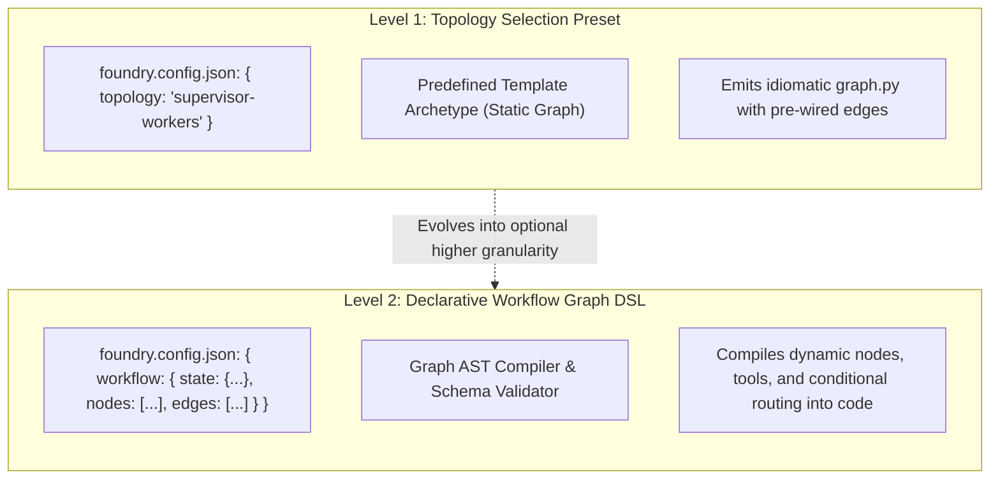
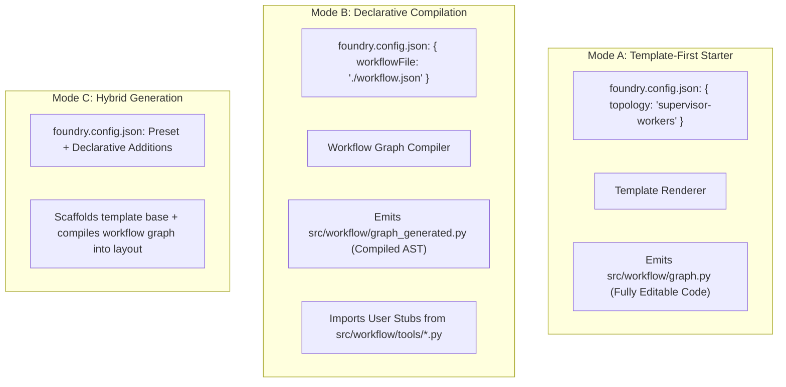

# Foundry — Consolidated Repository Audit, Architecture Evaluation & Phased Roadmap

> **Document Status: PROPOSED / WORKING PLAN — PENDING REVIEW**  
> *This document represents an ongoing architectural proposal and working plan for evaluation. It is NOT an approved, frozen, or finalized specification. All architectural models, schema proposals, and milestone scopes are subject to experimental validation, prototyping spikes, and explicit stakeholder review.*

---

## 1. Epistemic Baseline: Verified Audit Evidence vs. Proposals vs. Assumptions

To maintain strict engineering rigor, this document separates every factual finding, proposed design, and working hypothesis into three distinct epistemic categories:

```text
EPISTEMIC DISCIPLINE MATRIX
┌──────────────────────────────────────┬──────────────────────────────────────┬──────────────────────────────────────┐
│      VERIFIED REPO FINDINGS          │       ARCHITECTURAL PROPOSALS        │       ASSUMPTIONS & HYPOTHESES       │
│  (Proven by source code & tests)     │    (New designs to meet goals)       │   (Requires experiment / spike)      │
├──────────────────────────────────────┼──────────────────────────────────────┼──────────────────────────────────────┤
│ • Pure functional core (context ->   │ • Clean 3-tier capability separation │ • Developers prefer editing native   │
│   files) in src/core/generator.ts    │ • Dedicated foundry.config.json file │   code over configuring JSON graphs  │
│ • Side-effect writes in writer.ts    │ • Decoupled Scaffolding Components   │ • A universal workflow schema can    │
│ • 7 AI tool adapters in src/adapters │ • Phased validation of Agent Work-   │   map to LangGraph without leakiness │
│ • Path traversal flaw in paths.ts:19 │   flow definitions (Template vs JSON)│ • File-pointer symbols (:function)   │
│ • Flawed golden test in golden.ts:61 │ • Formal JSON Schema publishing      │   provide sufficient extensibility   │
│ • GitHub Issue #1 (CONTRIBUTING.md)  │ • Plan-First Execution Pipeline      │ • Multi-node dependencies can be     │
│ • 27 passing tests (Vitest 2.1.9)    │                                      │   resolved via a flat DAG            │
└──────────────────────────────────────┴──────────────────────────────────────┴──────────────────────────────────────┘
```

### 1.1 Verified Repository Findings
1. **Deterministic Pure Core Pipeline:**  
   [`src/core/generator.ts`](file:///d:/Extentions/Foundry/src/core/generator.ts#L26-L121) contains zero generative model calls, zero network dependencies, and zero disk I/O. It maps a [`ResolvedWorkspaceContext`](file:///d:/Extentions/Foundry/src/config/schema.ts#L59) strictly in memory to an array of immutable `GeneratedFile` objects. Determinism is asserted in [`tests/integration/generator.test.ts`](file:///d:/Extentions/Foundry/tests/integration/generator.test.ts#L20-L28).
2. **Security Vulnerability in Path Containment ([`src/io/paths.ts`](file:///d:/Extentions/Foundry/src/io/paths.ts#L15-L24)):**  
   The current path check relies on `if (!resolvedTarget.startsWith(resolvedBase))`. If `baseDir` is `/var/app` and `relativePath` resolves to `/var/app-secret/file.txt`, `startsWith` returns `true` despite traversing outside the intended base directory.
3. **Flawed Fixture Validation in Golden Tests ([`tests/golden/golden.test.ts`](file:///d:/Extentions/Foundry/tests/golden/golden.test.ts#L57-L71)):**  
   The `beforeAll` hook in the golden test regenerates and overwrites all golden fixtures on disk prior to asserting them. Any regression in generator logic will overwrite the fixtures, defeating the purpose of golden regression testing.
4. **Scope of GitHub Issue #1 ([`src/templates/contributing.ts`](file:///d:/Extentions/Foundry/src/templates/contributing.ts)):**  
   The existing contribution template provides only a basic 5-step build workflow and a brief AI guardrails mention. It lacks Conventional Commits structure, commit types, branch naming patterns, and atomic pull request guidelines.
5. **No Existing Application Scaffolding in V1:**  
   Foundry currently creates workspace metadata (`ai-workspace.yaml`, `.ai/`, `docs/`, `AGENTS.md`, etc.), but does not scaffold executable application code (routes, controllers, models, build tools, runtimes).
6. **Verified Behavior of `ai-workspace.yaml` in V1:**  
   - *Generated Workspace Contract:* Generated by [`src/core/generator.ts`](file:///d:/Extentions/Foundry/src/core/generator.ts#L33-L36) via [`renderManifest()`](file:///d:/Extentions/Foundry/src/templates/manifest.ts) as the target project's canonical AI contract.
   - *Dogfooding & Test Usage:* Foundry's own root `ai-workspace.yaml` is parsed in [`tests/integration/dogfood.test.ts`](file:///d:/Extentions/Foundry/tests/integration/dogfood.test.ts#L11-L30) via regex to assert that reference generation matches root files.
   - *CLI Input Behavior:* In V1, the CLI command ([`src/cli/command.ts`](file:///d:/Extentions/Foundry/src/cli/command.ts)) does **not** read `ai-workspace.yaml` as an input file. CLI inputs are gathered strictly via Commander flags or `@clack/prompts`.
   - *Runtime File-Reading:* The CLI never reads or parses `ai-workspace.yaml` from disk during normal scaffolding execution.

### 1.2 Architectural Proposals
1. **Decouple Capabilities:** Separate Workspace Generation, Project Scaffolding, and AI Agent Workflow Generation into independent layers.
2. **Dedicated Configuration Contract:** Introduce `foundry.config.json` with an accompanying JSON Schema (`schemas/foundry.config.schema.json`).
3. **Plan-First Generation Engine:** Adopt a `Load -> Validate -> Resolve -> Preview -> Execute -> Report` pipeline.

### 1.3 Assumptions & Hypotheses (Requiring Validation)
1. *Hypothesis 1:* A declarative workflow definition can capture branching, state schemas, and tool calling without becoming an awkward re-implementation of a programming language.
2. *Hypothesis 2:* Developers will benefit from a hybrid model where declarative graphs compile into editable native code rather than an opaque runtime interpreter.
3. *Hypothesis 3:* Cross-platform path normalization using POSIX relative paths is sufficient across Windows, macOS, and Linux without native symlink issues.

---

## 2. Rigorous Terminology & Capability Disambiguation

To eliminate architectural ambiguity, we establish formal definitions across the three product capabilities and the internal component system:

```text
FOUNDRY CAPABILITY TAXONOMY
┌────────────────────────────────────────────────────────────────────────────────────────┐
│ 1. WORKSPACE GENERATION (Metadata & Governance)                                        │
│    Target: Human developers & AI coding tools (Cursor, Claude, Copilot, Antigravity).  │
│    Artifacts: ai-workspace.yaml, AGENTS.md, CLAUDE.md, .ai/, docs/, CONTRIBUTING.md.  │
├────────────────────────────────────────────────────────────────────────────────────────┤
│ 2. PROJECT SCAFFOLDING (Application Infrastructure & Stack)                            │
│    Target: Operating system, package manager, compiler/runtime.                        │
│    Artifacts: package.json, pyproject.toml, src/main.py, Dockerfile, postgres setup.   │
├────────────────────────────────────────────────────────────────────────────────────────┤
│ 3. AI AGENT WORKFLOW GENERATION (Agent Runtime Business Logic)                         │
│    Target: Agent runtime frameworks (LangGraph, CrewAI, AutoGen).                      │
│    Artifacts: State definitions, execution graphs, agent loops, tools, edge routing.   │
└────────────────────────────────────────────────────────────────────────────────────────┘
```

### Disambiguating "Nodes" Across the Architecture

| Entity Term | Layer | Scope | Example |
|---|---|---|---|
| **Scaffolding Component** (`scaffold.component.json`) | Project Scaffolding (Layer 2) | An internal or external packaging unit describing templates, dependencies, and files needed to scaffold a tech stack. | `backend.fastapi`, `database.postgresql`, `infra.docker` |
| **Agent Execution Node** (`WorkflowNode`) | AI Agent Workflow (Layer 3) | A discrete computational step inside an agent state graph (e.g. an LLM call, a tool execution, or a human checkpoint). | `researcher_agent`, `tool_node`, `supervisor_node` |
| **Workflow Topology Preset** | AI Agent Workflow (Layer 3) | A coarse-grained architectural layout selecting a predefined graph pattern. | `supervisor-workers`, `sequential-pipeline`, `react-loop` |

---

## 3. Deep Analysis: Predefined Topologies vs. Declarative Workflow Graphs

Two fundamentally different levels of workflow generation must be distinguished:



### Level 1: Predefined Workflow Topology Selection (Coarse-Grained)
The user selects a known multi-agent pattern from a curated set:
- **`supervisor-workers`:** Central coordinator LLM routes tasks to specialized worker agents and synthesizes outputs.
- **`sequential-pipeline`:** Linear handoff chain (e.g., Ingestion $\to$ Extraction $\to$ Summarization).
- **`react-loop`:** Single or multi-turn agent that iteratively reasons, calls registered tools, and halts on completion.
- **`hierarchical-teams`:** Nested teams with sub-supervisors.

*Characteristics:*  
- Expressed via a simple enum or configuration block (e.g., `"agentWorkflow": { "framework": "langgraph", "topology": "supervisor-workers", "agents": ["researcher", "coder"] }`).
- Highly robust; template authors test the exact graph structure in advance.
- Minimal configuration burden on the user.
- Inflexible for developers whose desired execution graph does not fit the preset.

### Level 2: Declarative Workflow Graph Definition (Fine-Grained DSL)
The user defines an arbitrary graph structure in JSON:
- **State Schema:** Typed keys that persist across transitions (e.g., messages, scratchpad, context).
- **Nodes:** Specific execution steps (LLM call, deterministic tool, human review checkpoint).
- **Edges:** Unconditional directed transitions ($A \to B$).
- **Conditional Routing:** Dynamic edges determined by state predicate functions ($A \to B$ if `should_continue`, else $A \to \text{END}$).
- **Tools & Custom References:** Pointers to custom python/typescript functions.

*Characteristics:*  
- Expressed via an explicit graph specification schema.
- Highly flexible; capable of expressing arbitrary DAGs and cyclic state graphs.
- Requires building a graph compiler, semantic validator, cycle detector, and framework code emitter.
- Higher risk of generating invalid or non-compiling agent code if expressions or type contracts are malformed.

---

## 4. Evaluation of Declarative Workflow Abstraction Strategies

If Foundry supports a declarative workflow definition, how should it model framework abstractions? We evaluate three architectural models:

```text
MODEL 1: Universal Abstraction       MODEL 2: Framework-Specific         MODEL 3: Hybrid Common Core
┌───────────────────────────────┐   ┌───────────────────────────────┐   ┌───────────────────────────────┐
│     Universal Workflow        │   │      LangGraph Native         │   │       Common Graph Core       │
│     JSON Specification        │   │      JSON Specification       │   │    (id, state, nodes, edges)  │
└──────────────┬────────────────┘   └──────────────┬────────────────┘   └───────┬───────────────┬───────┘
               │                                   │                            │               │
       ┌───────┴───────┐                           │                            ▼               ▼
       ▼               ▼                           ▼                     LangGraph Ext     CrewAI Ext
   LangGraph        CrewAI                     LangGraph                    Config           Config
   Compiler        Compiler                     Emitter                     Block            Block
```

### Model 1: Framework-Independent Abstraction with Framework Adapters
Foundry defines an abstract, engine-agnostic workflow schema. Framework adapters compile this universal JSON into LangGraph, CrewAI, AutoGen, or raw native code.

- **Strengths:** Single declarative specification; portable across framework migrations.
- **Limitations & Trade-offs:**  
  - *The Lowest-Common-Denominator Problem:* Frameworks have incompatible runtime paradigms. LangGraph is a low-level cyclic state machine; CrewAI is an autonomous role-playing model; AutoGen is a conversational event bus. A universal schema either loses framework-specific strengths (e.g., LangGraph checkpoints, time-travel, subgraphs) or becomes bloated with leaky abstractions.
  - High compiler maintenance cost as target frameworks evolve their APIs.

### Model 2: Framework-Specific Schema from the Beginning
Foundry does not attempt a universal workflow abstraction. Instead, it provides dedicated, framework-specific JSON schemas (e.g. `langgraph.workflow.schema.json`).

- **Strengths:**  
  - 1:1 conceptual mapping to framework primitives.
  - Zero loss of framework capabilities; full support for LangGraph `StateGraph`, `MemorySaver`, conditional entry points, and interrupts.
  - Much simpler compiler implementation; directly translates JSON structures into standard framework code idioms.
- **Limitations & Trade-offs:**  
  - Zero workflow portability. Switching from LangGraph to CrewAI requires authoring a completely different workflow specification.
  - Foundry must maintain separate schema definitions and emitters for each supported framework.

### Model 3: Hybrid Model (Common Core + Framework Extensions)
Foundry defines a small, standardized core contract for universal graph primitives (graph identity, state keys, standard node types, directed edges, tool references) combined with framework-specific extension blocks.

```json
{
  "graph": {
    "id": "customer-support-agent",
    "state": {
      "messages": { "type": "list[Message]", "reducer": "append" },
      "customer_id": { "type": "string" }
    },
    "nodes": [
      { "id": "triage", "type": "llm", "prompt": "prompts/triage.md" },
      { "id": "crm_lookup", "type": "tool", "handler": "./tools/crm.py:lookup_customer" }
    ],
    "edges": [
      { "from": "__START__", "to": "triage" },
      { "from": "triage", "to": "crm_lookup", "condition": "./conditions/routing.py:needs_lookup" }
    ]
  },
  "frameworkExtensions": {
    "langgraph": {
      "checkpointer": "MemorySaver",
      "interruptBefore": ["human_approval_node"]
    }
  }
}
```

- **Strengths:**  
  - Captures the common graph structure while granting access to native framework superpowers.
  - Allows tooling (e.g., visual graph inspectors) to visualize the common DAG while framework engines consume the extension blocks.
- **Limitations & Trade-offs:**  
  - Requires careful schema governance to prevent extension blocks from overriding core semantics.

---

## 5. Safe Integration of Custom User Code (Zero-Execution Boundary)

A critical architectural mandate for Foundry is: **JSON must remain declarative and must NEVER execute arbitrary user code during generation.**

To connect declarative workflow graphs with custom user business logic (tools, condition predicates, state reducers, prompt formatters), Foundry uses **Symbol Reference Contracts**:

```text
DECLARATIVE CODE LINKING (Compile-Time Resolution):
┌──────────────────────────────────────┐
│       Declarative JSON Schema        │
│  "handler": "./tools/search.py:query"│
└──────────────────┬───────────────────┘
                   │  1. Parse file path & export symbol
                   ▼
┌──────────────────────────────────────┐
│       Foundry Generation Engine      │
│  - Verifies path containment         │
│  - Verifies or stubs file on disk    │
│  - Generates typed import statement  │
└──────────────────┬───────────────────┘
                   │  2. Emits compiled native code
                   ▼
┌──────────────────────────────────────┐
│         Generated Python/TS          │
│  from tools.search import query      │
│  graph.add_node("search", query)     │
└──────────────────────────────────────┘
```

### Safety Rules for Symbol References:
1. **No Runtime Invocations:** Foundry parses the string `./tools/search.py:query` as metadata. It never imports, executes, or evals the target file during scaffolding.
2. **Path Containment:** The file path must be verified using strict relative containment to guarantee it stays within the target project workspace.
3. **Deterministic Stubbing:** If the referenced file does not exist, Foundry scaffolds a typed stub signature:
   ```python
   # Auto-generated stub by Foundry
   def query(state: AgentState) -> dict:
       """Custom tool stub. Implement tool logic here."""
       raise NotImplementedError("Tool 'query' not implemented yet.")
   ```
4. **Generated Import Emission:** The compiler converts verified symbol references into standard language import statements in the generated graph module.

---

## 6. Coexistence Architecture: How Template Starters and JSON Workflows Interact

Template-first starters and JSON-defined workflows are not mutually exclusive. They represent complementary layers in a progressive disclosure model:



### Coexistence Patterns:
1. **Pattern 1 (Base Project Scaffolding + Modular Graph Insertion):**  
   Project scaffolding generates the directory layout, dependencies, environment management, and test runners. The workflow engine (whether driven by a template starter or a JSON compiler) generates only the workflow package (`src/workflow/`).
2. **Pattern 2 (Ejection / Code Generation):**  
   The JSON workflow compiler operates as a **one-time code emitter**, not a runtime virtual machine. It compiles `workflow.json` into readable, idiomatic Python/TypeScript code (`graph.py`). The developer can either keep updating `workflow.json` and re-generating or "eject" and continue editing native code directly.
3. **Pattern 3 (Generated Graph vs. User Hooks Separation):**  
   To prevent code loss during re-generation:
   - Generated graph structure lives in `src/workflow/graph_generated.py`.
   - Developer hooks, state reducers, and tools live in `src/workflow/tools/` and `src/workflow/hooks/`.
   - Entry point `src/workflow/graph.py` combines generated wiring with developer implementations.

---

## 7. Reassessed Phased Release Roadmap

Roadmap milestones are organized strictly around **dependencies, validation needs, and realistic MVPs**, rather than arbitrarily deferring complex capabilities:

```text
REBALANCED RELEASE ROADMAP:
┌────────────────────┐      ┌────────────────────┐      ┌────────────────────┐      ┌────────────────────┐
│      v1.0.1        │ ───> │      v1.1.0        │ ───> │      v1.2.0        │ ───> │      v2.0.0        │
│ Patch & Hardening  │      │ Scaffolding MVP &  │      │ Declarative Graph  │      │ Multi-Framework &  │
│ - Security fixes   │      │ Curated Starters   │      │ Pilot (LangGraph)  │      │ Ecosystem          │
│ - Golden test fix  │      │ - foundry.config   │      │ - JSON workflow DSL│      │ - CrewAI/AutoGen   │
│ - GitHub Issue #1  │      │ - FastAPI/Express  │      │ - Compiler spike   │      │ - External node    │
│ - Docs hierarchy   │      │ - Template Starters│      │ - Graph preview    │      │   distribution     │
└────────────────────┘      └────────────────────┘      └────────────────────┘      └────────────────────┘
```

### Milestone v1.0.1: Maintenance, Security & Issue #1 (Immediate)
*Objective: Stabilize existing V1 codebase, resolve technical debt, and close GitHub Issue #1 without introducing breaking changes.*
- **Scope:**
  - **FEAT-101:** Extend [`src/templates/contributing.ts`](file:///d:/Extentions/Foundry/src/templates/contributing.ts) with Conventional Commits, branch naming conventions, atomic PR standards, and commit types (GitHub Issue #1).
  - **FEAT-102:** Harden [`src/io/paths.ts`](file:///d:/Extentions/Foundry/src/io/paths.ts#L15-L24) against prefix path traversal by enforcing `path.relative` containment logic.
  - **FEAT-103:** Refactor [`tests/golden/golden.test.ts`](file:///d:/Extentions/Foundry/tests/golden/golden.test.ts) to verify against committed immutable reference fixtures, gating snapshot updates behind an explicit `UPDATE_SNAPSHOTS` environment flag.
  - **FEAT-104:** Reorganize internal documentation hierarchy into `docs/architecture/`, `docs/specifications/`, and `docs/planning/`.
- **Explicit Exclusions:** No new CLI commands, no new configuration files, no application scaffolding code.

---

### Milestone v1.1.0: Config-Driven Scaffolding & Curated Agent Starters
*Objective: Introduce the project scaffolding engine, `foundry.config.json`, and production-grade curated agent workflow starters.*
- **Scope:**
  - **FEAT-201 (Config Engine):** Support `npx create-foundry-workspace --config ./foundry.config.json` with formal JSON schema validation.
  - **FEAT-202 (Plan-First Dry-Run):** CLI output formatting displaying full generation plan, detected collisions, and file resolutions before writing.
  - **FEAT-203 (Core Project Scaffolding):**
    - Python FastAPI backend starter (modular routes, pydantic settings, health check, pytest suite).
    - Node.js Express / TypeScript backend starter.
    - Infrastructure components: Dockerfile, `docker-compose.yml`, and CI workflows.
  - **FEAT-204 (AI Agent Workflow Starters — Template-First):**
    - Curated LangGraph Python workflow starters for standard topologies (`supervisor-workers`, `react-loop`).
    - Safe credential management via typed `.env.example` templates and validation schemas.
  - **FEAT-205 (Internal Scaffolding Component System):** Declarative `scaffold.component.json` manifests for composing internal scaffolding building blocks.
  - **SPIKE-206 (Declarative Workflow Spike):** Author a proof-of-concept JSON schema for LangGraph graphs to evaluate in v1.2.0.
- **Explicit Exclusions:** Declarative JSON workflow compilation is in research/spike mode during v1.1.0, not shipped as a production feature.

---

### Milestone v1.2.0: Declarative Workflow Graph Engine Pilot
*Objective: Deliver the declarative JSON agent workflow compiler for LangGraph, alongside expanded application stacks.*
- **Scope:**
  - **FEAT-301 (Declarative Workflow Compiler — LangGraph Pilot):**
    - Implement `foundry.workflow.schema.json` supporting state schemas, nodes, unconditional/conditional edges, and tool symbol references.
    - Build graph AST compiler that generates idiomatic Python LangGraph `StateGraph` code.
    - CLI command `foundry preview-graph ./workflow.json` rendering an ASCII/Mermaid preview of the declared workflow graph.
  - **FEAT-302 (Coexistence Mode):** Allow projects to use both template starters and custom JSON graph compilation.
  - **FEAT-303 (Additional Scaffolding Components):** React / Vite and Next.js frontend scaffolding; PostgreSQL / Prisma / SQLAlchemy integrations.
  - **FEAT-304 (Interactive Config Authoring):** `foundry init-config` interactive wizard.
- **Explicit Exclusions:** Multi-framework abstraction across CrewAI/AutoGen is deferred until LangGraph compilation is thoroughly validated.

---

### Milestone v2.0.0: Universal Workflow Abstractions & Ecosystem Extensibility
*Objective: Multi-framework agent workflow compilation and community scaffolding module ecosystem.*
- **Scope:**
  - **FEAT-401 (Multi-Framework Workflow Adapters):** Extend declarative workflow generation to CrewAI and AutoGen based on v1.2.0 learnings.
  - **FEAT-402 (External Community Scaffolding Components):** Secure loading and verification of third-party scaffolding components from local directories or trusted Git repos.
  - **FEAT-403 (Schema Migration Engine):** Automated migration tools for updating older `foundry.config.json` configurations.

---

## 8. Explicit Out-of-Scope Boundaries

The following capabilities are explicitly declared **OUT OF SCOPE**:

1. **Foundry as an Agent Execution Runtime:** Foundry is a *generator*, never an execution runtime. It scaffolds code for LangGraph or CrewAI; it does not run, schedule, or orchestrate agent tasks in production.
2. **Arbitrary Code Execution in Declarative Schemas:** JSON files will never contain executable JavaScript, Python, or shell code blocks. All dynamic logic must reside in referenced source code files.
3. **Remote Package Registry on Day 1:** Foundry will not build a centralized package hosting registry or download unverified executable scripts from arbitrary URLs.
4. **Runtime LLM Invocations:** Foundry’s core remains strictly zero-LLM. It scaffolds AI projects, but never calls LLM APIs to generate the code.

---

## 9. Open Decisions, Required Evidence & Validation Spikes

Before freezing the architecture for v1.1.0 and v1.2.0, the following core decisions require review (tracked in [`docs/planning/DECISION_LOG.md`](./DECISION_LOG.md)), along with the concrete spikes needed to inform them:

### OPEN-001: Three-Layer Capability Separation
- **Question:** Does the decoupling between Layer 1 (Workspace Generation), Layer 2 (Project Scaffolding), and Layer 3 (AI Agent Workflow Generation) provide the right boundary separation?
- **Current Assessment:** Yes. It preserves V1 stability while enabling application scaffolding without confusing scaffolding components with agent execution nodes.

### OPEN-002: Scaffolding Component Architecture vs. Agent Execution Nodes
- **Question:** Should Layer 2 scaffolding modules be structured as `scaffold.component.json` in `src/scaffolding/`, rejecting the ambiguous `src/nodes/`?
- **Current Assessment:** Yes. Eliminates confusion with agent graph execution nodes.
- **Required Evidence / Spike:** Author a sample `scaffold.component.json` for FastAPI and test dependency resolution.

### OPEN-003: AI Agent Workflow Strategy (Template-First Starter vs. Declarative Graph Compiler)
- **Question:** Should v1.1 deliver a curated template starter (LangGraph Python) while v1.2 pilots declarative JSON graph compilation?
- **Current Assessment:** Yes. Delivers immediate developer ergonomics while giving time to spike the graph compiler without delaying v1.1.
- **Required Evidence / Spike:** Author a sample 4-node research agent in both formats and benchmark developer maintenance burden.

### OPEN-004: Compile-Time Symbol Reference Contract for Custom Code
- **Question:** Should declarative workflow graphs reference custom user tools and condition predicates via string symbol pointers (`path:symbol`) without executing arbitrary code during scaffolding?
- **Current Assessment:** Yes. Strictly preserves the zero-arbitrary-code-execution security boundary.
- **Required Evidence / Spike:** Prototype TypeScript import emission for target Python files.

### OPEN-005: Dedicated `foundry.config.json` Configuration Contract
- **Question:** Is a dedicated `foundry.config.json` with JSON Schema validation the optimal interface for headless execution (`--config`)?
- **Current Assessment:** Yes. Enables Git-versioned workspace definitions and CI reproducibility.
- **Required Evidence / Spike:** Export draft JSON Schema and test IDE schema validation.

---
*End of Proposed / Working Plan.*
