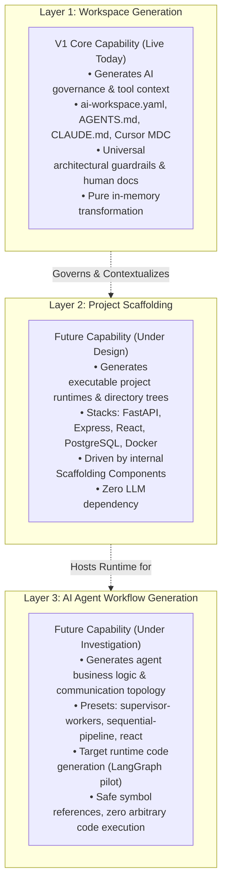

# Foundry Product Vision & Capability Layers

## 1. Executive Summary & Purpose

**Foundry** is a deterministic, local-first developer tool distributed via npm as `create-foundry-workspace`. Its purpose is to eliminate configuration drift, prompt recreation, and architectural inconsistency when setting up modern software workspaces for human engineers and AI coding assistants.

---

## 2. Core Philosophy & Principles

1. **Strict Determinism:** Identical configuration inputs and package versions must produce bit-for-bit identical generated outputs every time. No random UUIDs, dynamic timestamps, or machine-specific absolute paths.
2. **Zero-LLM Generation Boundary:** Foundry's scaffolding core contains zero generative AI models, zero network dependencies, and zero stochastic heuristics. It generates AI-ready projects; it does not invoke LLMs to generate them.
3. **Local-First & Offline:** Scaffolding executes 100% locally on the developer's machine with zero telemetry and zero external service calls.
4. **Dogfooding Discipline:** Foundry's own repository is governed by the same workspace contracts, instruction files, and guardrails it generates for users.
5. **Pure Functional Core:** Generation logic operates strictly in memory, separated completely from the filesystem I/O boundary.

---

## 3. The Three Product Capability Layers

To maintain architectural clarity and prevent component conflation, Foundry defines three strictly decoupled product layers:

### Layer 1: Workspace Generation (V1 Core — Active)
- **Role:** Generates workspace governance, architectural guardrails, and tool-specific instruction files for AI coding assistants (Cursor, Claude Code, GitHub Copilot, Google Antigravity/Gemini CLI, and multi-agent open standards).
- **Target:** Human developers and AI coding assistants.
- **Output:** Machine contract ([`ai-workspace.yaml`](file:///d:/Extentions/Foundry/docs/specifications/SPECIFICATION.md)), documentation ([`docs/`](file:///d:/Extentions/Foundry/docs/architecture/ARCHITECTURE.md)), intelligence scratchpads (`.ai/`), and tool prompt adapters (`AGENTS.md`, `CLAUDE.md`, `.cursor/rules/*.mdc`, etc.).
- **Implementation Status:** Fully implemented and tested in V1.

### Layer 2: Project Scaffolding (Planned Feature)
- **Role:** Scaffolds concrete, executable application code, dependency manifests, database connections, containerization, and automated test runners.
- **Target:** Operating system, package managers (npm, pip, cargo), compilers, and runtimes.
- **Output:** Executable project structures (e.g. `src/main.py`, `package.json`, `Dockerfile`, `docker-compose.yml`).
- **Implementation Status:** Planned for milestone v1.1.0 via internal Scaffolding Components.

### Layer 3: AI Agent Workflow Generation (Research & Proposal)
- **Role:** Scaffolds executable multi-agent workflows, state schemas, tool-calling loops, and execution graphs for agent runtime frameworks (e.g., LangGraph).
- **Target:** Agent runtime engines in application space.
- **Output:** Runnable agent workflow source code (`workflow/graph.py`, `workflow/state.py`).
- **Implementation Status:** Planned for v1.1 (curated code starters) and v1.2 (declarative graph compiler pilot).

---

## 4. Explicit Non-Goals & Boundaries

To preserve stability and architectural focus, the following capabilities are explicitly **out of scope**:

1. **Foundry is NOT an Agent Execution Runtime:** Foundry is a generator, not a runtime virtual machine. It scaffolds code for LangGraph or CrewAI; it does not execute agent loops, schedule background tasks, or run production agent swarms.
2. **Zero Arbitrary Code Execution in Declarative Schemas:** Configuration files and schemas will never accept or evaluate arbitrary JavaScript, Python, or shell code during generation.
3. **No Centralized Remote Package Hosting on Day 1:** Foundry will not download unverified code from third-party URLs. All official scaffolding components and templates are bundled locally within the npm package.
4. **No LLM API Calls at Scaffolding Time:** Foundry never calls OpenAI, Anthropic, Gemini, or any LLM API to generate files. Generation is 100% deterministic and rule-driven.

---

## 5. Cross-Document Navigation

- For detailed disambiguation between Scaffolding Components and Workflow Nodes, see [docs/product/TERMINOLOGY.md](TERMINOLOGY.md).
- For V1 engine mechanics and the pure generation core, see [docs/architecture/ARCHITECTURE.md](../architecture/ARCHITECTURE.md).
- For the full repository audit and phased evolution roadmap, see [docs/planning/FOUNDRY_AUDIT_AND_ROADMAP.md](../planning/FOUNDRY_AUDIT_AND_ROADMAP.md).
